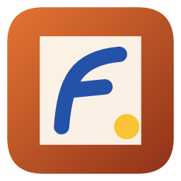

# Ferrum Paint

Ferrum Paint is a layered raster image editor for **Windows** and **Ubuntu 26.04**, written in Rust with [egui](https://github.com/emilk/egui) (UI) and [tiny-skia](https://github.com/RazrFalcon/tiny-skia) (rendering). Its workflow, layout, tools and keyboard shortcuts follow the conventions of Paint.NET. The same code paths run on both platforms, so it behaves the same on each.



## Clean-room statement

Ferrum Paint is an independent clean-room implementation. Its behaviour is based only on Paint.NET's **public user documentation** (see [docs/REFERENCE_NOTES.md](docs/REFERENCE_NOTES.md) for the sources). No Paint.NET binaries were decompiled or inspected, and no code, icons, images or other assets were copied. All icons are drawn procedurally in `src/icons.rs`. Ferrum Paint is not affiliated with or endorsed by Paint.NET or dotPDN LLC.

## Features

- **Paint.NET-style layout**
  - Menu bar with image thumbnail tabs, a main toolbar and a per-tool options bar.
  - Floating Tools, History, Layers and Colors windows (toggle with F5–F8) and a status bar.
- **Tools**
  - Selection: Rectangle Select, Lasso Select, Ellipse Select and Magic Wand. Each supports replace, add (Ctrl), subtract (Alt), invert and intersect.
  - Move: Move Selected Pixels and Move Selection, both with drag, right-drag rotate and arrow-key nudge.
  - Navigation: Zoom and Pan.
  - Painting: Paint Bucket, Gradient, Paintbrush, Eraser, Pencil, Color Picker, Clone Stamp and Recolor.
  - Drawing: Text, Line / Curve and Shapes.
- **Shapes tool** with two drawing modes, chosen in the options bar under **Draw from: Corner / Centre**:
  - *Corner*: the drag runs from one corner to the opposite corner.
  - *Centre*: the drag starts at the centre and grows the shape outwards symmetrically.
  - Holding **Alt** while dragging switches to the other mode for that shape.
  - **Shift** constrains proportions (square or circle).
  - There are 14 shape types: rectangle, rounded rectangle, ellipse, triangle, right triangle, diamond, pentagon, hexagon, octagon, star, arrow, heart, cross and speech bubble. Press A or Shift+A to cycle through them.
  - Draw modes are outline, filled, or filled with an outline. The primary colour draws the outline and the secondary colour fills.
  - A shape stays editable after you draw it. Drag inside it to move it or drag a handle to resize it, then press Enter (or switch tool) to finish.
- **Layers**: add, delete, duplicate, merge down, move up or down, visibility, and properties (name, opacity, blend mode). A full undo/redo history is kept in the History window.
- **Image menu**: crop to selection, resize (with resampling choice), canvas size (with anchor), flip, rotate 90°/180°, flatten, and Rotate/Zoom layer.
- **Adjustments** (13): Auto-Level, Black and White, Brightness/Contrast, Curves, Exposure, Highlights/Shadows, Hue/Saturation, Invert Alpha, Invert Colors, Levels, Posterize, Sepia (with intensity), and Temperature and Tint.
- **Effects** (47, in the same submenus as Paint.NET):
  - Artistic: Ink Sketch, Linocut, Mosaic, Oil Painting, Pencil Sketch, Pointillism, Stained Glass.
  - Blurs: Bokeh, Fragment, Gaussian, Median, Motion, Radial, Sketch, Square, Surface, Zoom.
  - Color: Quantize (median cut or octree, with dithering).
  - Distort: Bulge, Crystalize, Dents, Frosted Glass, Morphology, Pixelate, Polar Inversion, Spherize, Tile Reflection, Twist, Waves.
  - Noise: Add Noise, Reduce Noise. Object: Drop Shadow.
  - Photo: Glow, Red Eye Removal, Sharpen, Soften Portrait, Straighten, Vignette.
  - Render: Clouds, Julia Fractal, Mandelbrot Fractal, Turbulence (with blend modes).
  - Stylize: Edge Detect, Emboss, Halftone, Outline, Relief.
  - Dialogs are generated from each effect's parameter list: sliders, an angle dial, drop-downs, colour pickers, a centre-point pad over a thumbnail of the layer, Reseed and Reset.
  - The preview renders on a background thread, so the UI stays responsive. Cancel restores the original, and effects apply only inside the selection.
  - Ctrl+F repeats the last effect with the same settings.
- **Look**: light and dark themes (**View → Dark Theme**, remembered between sessions; the first run follows the system theme), native UI font (Segoe UI on Windows, Ubuntu on Ubuntu), compact tool-window headers.
- **Clipboard**: cut, copy, copy merged, paste, paste into new layer and paste into new image. Images are exchanged with other applications through the system clipboard.
- **Files**:
  - Native layered format: `.ferrum`. Like `.pdn`, it keeps every layer with its name, visibility, opacity and blend mode, so you can close the app and carry on later without merging anything.
  - New images save as `.ferrum` by default. If you save a layered image as PNG, JPEG or another flat format, Ferrum Paint asks first and offers **Save as .ferrum instead**. Flattening only affects the exported file; the open image keeps its layers.
  - File association: `install-linux.sh` registers the `application/x-ferrum-paint` MIME type on Ubuntu. On Windows, run `ferrum-paint.exe --register-file-type` once to make `.ferrum` files open in Ferrum Paint (current user only).  - Import and export: PNG, JPEG, BMP, GIF, TIFF, WebP, TGA and ICO. JPEG is composited over white; ICO is limited to 256×256.
  - Files can be opened from the command line or by drag-and-drop.
  - Saves are atomic: the file is written to a temporary file and then renamed.
  - Closing an image with unsaved changes asks before discarding them.

## Keyboard shortcuts (summary)

The full list is under **Help → Keyboard Shortcuts** (F1) in the app.

| Keys | Action |
|---|---|
| S, M, Z, H, F, G, B, E, P, K, L, R, T, O | Tool selection (press again to cycle within a group; O = Line/Curve, then Shapes) |
| A / Shift+A | Next / previous shape type |
| [ / ] | Brush width −1 / +1 (Ctrl: ±5) |
| X | Swap primary and secondary colours |
| Enter / Esc | Finish the current shape, line, text or gradient |
| Ctrl+N / O / S / Shift+S / W | New / Open / Save / Save As / Close |
| Ctrl+Z / Ctrl+Y | Undo / Redo |
| Ctrl+X / C / V, Ctrl+Shift+C / V, Ctrl+Alt+V | Cut, copy, paste, copy merged, paste into new layer, paste into new image |
| Ctrl+A / D / I | Select all / Deselect / Invert selection |
| Ctrl+Shift+X, Ctrl+R, Ctrl+Shift+R | Crop to selection, Resize, Canvas size |
| Ctrl+H / G / J | Rotate 90° clockwise / 90° anticlockwise / 180° |
| Ctrl+Shift+N / D / Del, Ctrl+M, F4 | Add / Duplicate / Delete layer, Merge down, Layer properties |
| Ctrl++ / Ctrl+- / Ctrl+0 / Ctrl+B | Zoom in / out / actual size / zoom to window |
| F5–F8 | Toggle Tools / History / Layers / Colors windows |
| Space + drag | Pan with any tool |

## Building

You need a recent stable Rust toolchain (installed through [rustup](https://rustup.rs)).

### Windows

```powershell
cargo build --release
.\target\release\ferrum-paint.exe
```

On some Windows setups, folders under `Documents` have a read-only attribute that cannot be cleared, often because of Controlled Folder Access or OneDrive. The build then fails with `output path is not a writable directory` (from `autocfg`). To fix this, point Cargo's output somewhere writable:

```powershell
$env:CARGO_TARGET_DIR = "$env:LOCALAPPDATA\ferrum-paint-target"
cargo build --release
```

### Ubuntu 26.04

Install the build dependencies, then build:

```bash
sudo apt install build-essential pkg-config libxkbcommon-dev libgl1-mesa-dev \
    libwayland-dev libx11-dev libxcursor-dev libxrandr-dev libxi-dev \
    xdg-desktop-portal xdg-desktop-portal-gtk
cargo build --release
./target/release/ferrum-paint
```

Ferrum Paint runs natively on both Wayland and X11. Its file dialogs use the XDG desktop portal. To install it for your user, with a menu entry and icons, run:

```bash
bash packaging/install-linux.sh
```

### Tests

```bash
cargo test
```

The tests run without a window and check the tool behaviour. They cover:

- Shapes in corner and centre modes, the Alt toggle, the Shift constraint, fill and outline colours, and editing with move and resize handles.
- Tool shortcuts and exact modifier matching.
- Text entry, invert within a selection, and undo.
- The `.ferrum` round-trip and PNG/JPEG export.
- Paintbrush strokes, and crop to selection.
- Every adjustment and effect: it runs with default settings, keeps the image size, changes the image, and leaves pixels outside the selection untouched.
- Saving a layered image to a flat format warns first and never merges the open document's layers.

To time every effect on a 2000 × 1500 image: `cargo test --release -- --ignored effect_timing --nocapture`. On the development machine each effect takes 0.2–2 s.

### Exporting the app icon

```bash
ferrum-paint --write-icon icon.png 256
```

## Project layout

| Path | Contents |
|---|---|
| `src/app.rs` | Application state, commands, shortcut mapping, save and close flow, clipboard |
| `src/ui.rs` | Menus, image tabs, toolbars, status bar, Tools/History/Layers windows |
| `src/colors.rs` | Colors window (colour wheel, sliders, hex, palette) |
| `src/canvas.rs` | Canvas view, tool input state machine, live previews |
| `src/document.rs` | Layers, documents, undo history |
| `src/raster.rs` | Pixel operations and the classic adjustments |
| `src/fx/` | Effect registry, parameter specs and all parametric adjustments and effects |
| `src/theme.rs` | Light and dark themes, UI fonts, tool-window headers, saved preferences |
| `src/paint.rs` | Shape, line, brush, text and gradient rasterisation (tiny-skia) |
| `src/dialogs.rs` | Modal dialogs and the shortcut table |
| `src/fileio.rs` | `.ferrum` format and image import/export |
| `src/icons.rs` | Procedurally drawn original icons |
| `vendor/egui-winit` | egui-winit 0.31.1, patched so that pasting image-only clipboard contents (Ctrl+V) works |

## Known limitations

- There is no printing, no plugin system, and no support for Paint.NET's `.pdn` files.
- Effects follow Paint.NET's names, menus and controls, but the algorithms are original, so results will not be pixel-identical. Mosaic offers 7 tile shapes rather than Paint.NET's 21. Fractal colouring uses our own palette.
- Effect previews of heavy effects on very large images take a second or two to appear.- The Text tool uses the two fonts bundled with egui. It does not use system fonts.
- The Ubuntu 26.04 build has not been tested on real hardware. Development and testing were done on Windows, and the Linux code paths rely on the platform layers of winit, arboard and rfd.

## Licence

Copyright © Tim Lorne. Add your preferred licence here before distributing.
